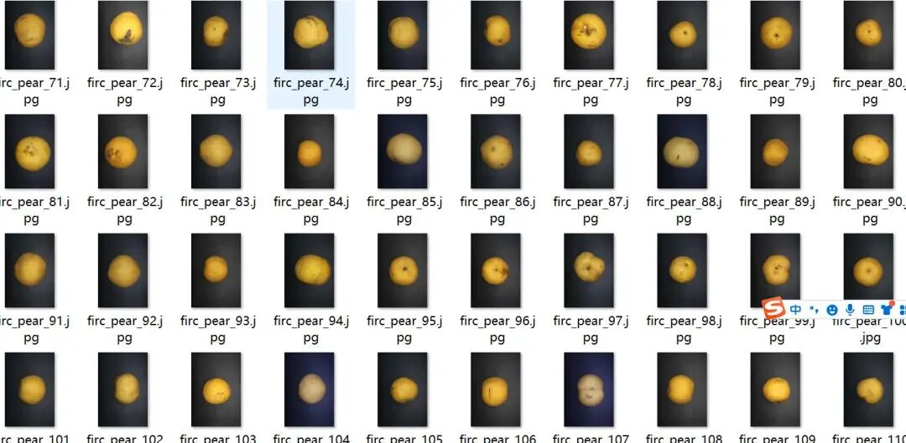
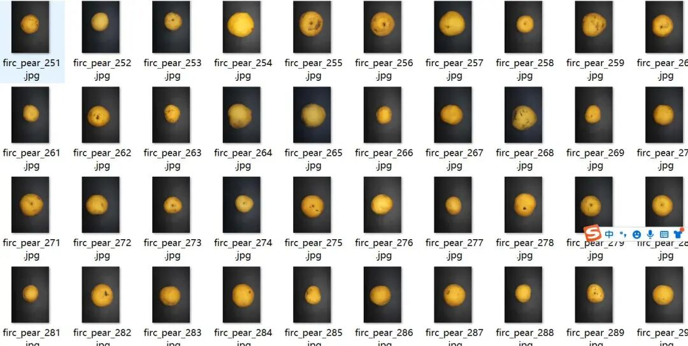
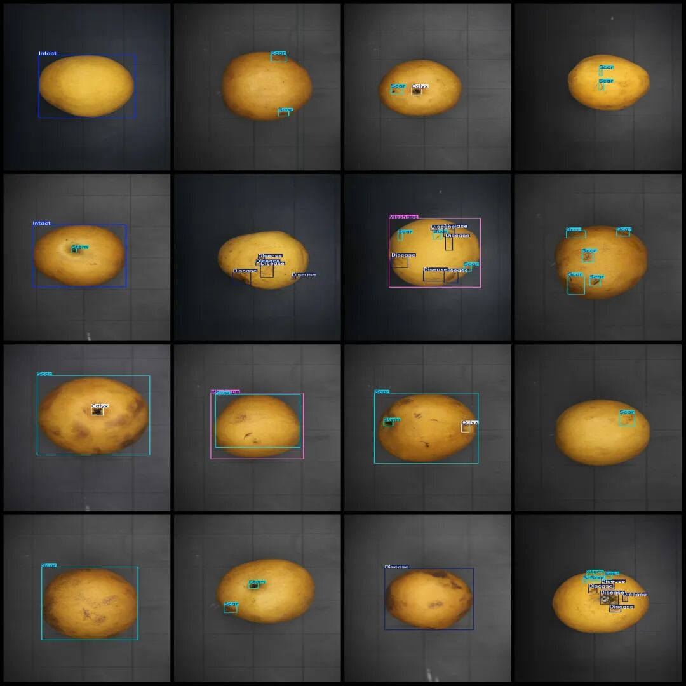
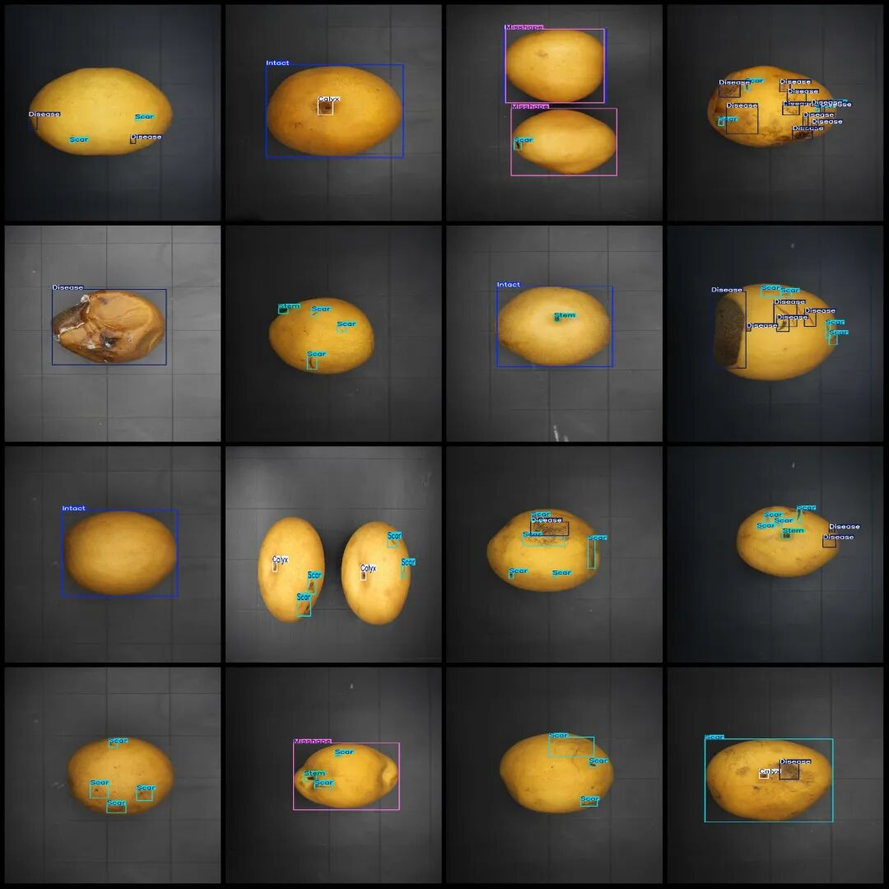

# Pear Disease Detection Dataset VOC+YOLO format with 1854 images in 7 categories

Dataset format: Pascal VOC format + YOLO format (txt file without split path, only containing jpg images and corresponding VOC format xml files and yolo format txt files)

Number of images (number of jpg files): 1854

Number of annotations (number of xml files): 1854

Number of annotations (number of txt files): 1854

Label category count: 7

Label category names (note that the order of categories in the YOLO format does not correspond to this, but is based on the labels folder's classes.txt): ["Calyx", "Disease", "Intact", "Miscolor", "Misshape", "Scar", "Stem"]

Number of boxes labeled in each category:

Calyx (flower bud) frame count = 373

Disease (disease) Frames = 2806

Intact (flawless) frame count = 207

Miscolor (discolor) frame count = 382

Misshape (deformed) frame count = 339

Scar (scar) frame count = 5176

Stem (fruit stem) frame count = 783

Total frame count: 10066

Image resolution: 1920x2880

Using labelImg:

Annotation rules: Draw a rectangle around the category.

Important Notice: No

Special : This dataset does not guarantee the accuracy of the trained models or weight files.

Image Preview:

Annotation example:

## Payment

Here is a pay link on Stripe ( https://buy.stripe.com/3cs8yP7sY87d0vu9AB ). Please contact me lonlonago@foxmail.com after funding $89, and I will send you a complete data files , thank you!

